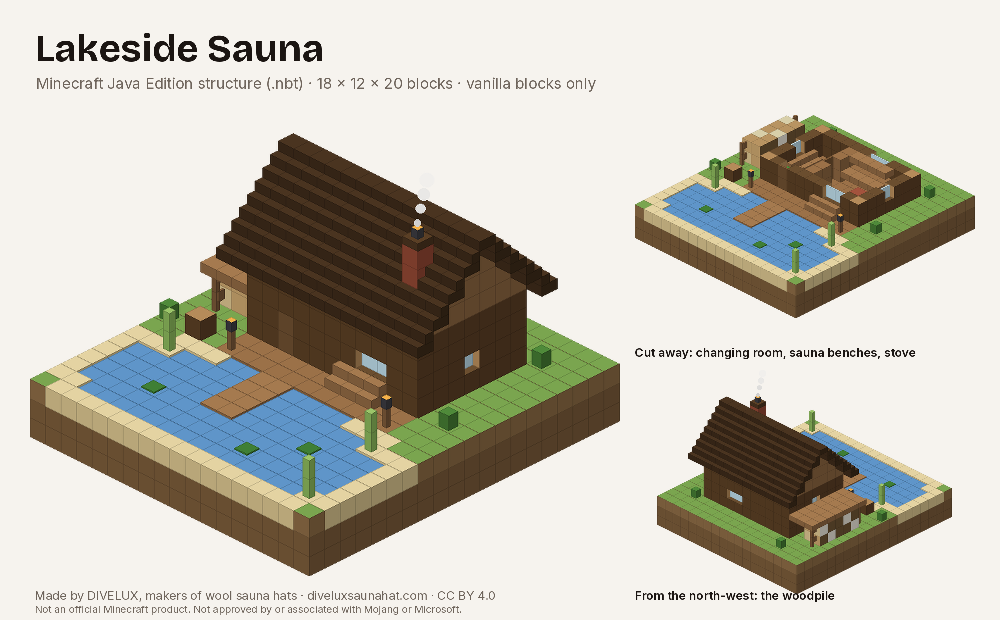

# Minecraft Build: Lakeside Sauna

A small Finnish sauna cabin by a pond, as a structure file for Minecraft Java Edition. Load it with a
Structure Block and it appears in your world in one click.

Made by DIVELUX, makers of handmade wool sauna hats — https://diveluxsaunahat.com



## What is in the build

18 × 12 × 20 blocks (x × y × z), vanilla blocks only, no entities, no command blocks.

- **Changing room:** spruce bench along the wall, a barrel with a folded white towel (carpet), a potted fern, a lantern
- **Sauna room:** two-step bench (lower step and upper bench), a stove (blast furnace) with a brick chimney through the
  roof and a campfire on top for smoke, a water cauldron as the water bucket, a lantern. The upper bench leaves
  2 blocks of headroom, so you can stand on it
- **Log cabin:** spruce log walls, glass pane windows, two spruce doors, dark oak gable roof with overhang
- **Outside:** a terrace with a bench facing the water, lanterns on posts, a woodpile of oak and birch logs under a
  lean-to roof, a chopping stump, a pond two blocks deep with a sandy shore, a short dock on posts, lily pads,
  sugar cane and ferns

The build includes its own ground: three layers (dirt, dirt, grass and sand) under and around the cabin, with the
pond dug into them. Everything else inside the 18 × 12 × 20 box is air, so loading the build clears trees, grass and
snow in that box.

## Files

| File | What it is |
|---|---|
| `lakeside-sauna.nbt` | The structure, DataVersion 5023: **Java Edition 26.3** (the latest release in November 2026) |
| `lakeside-sauna-1.21.1.nbt` | The same blocks with DataVersion 3955: **Java Edition 1.21.1**. Use this one for 1.21.1 up to 26.2 |
| `preview.png` | Outside view, a cut-away view and the view from the woodpile side |
| `view-outside.png`, `view-inside.png`, `view-woodpile.png` | The three views on their own, bigger |
| `layers.png` | Every layer seen from above with a key, for building it by hand in survival |
| `src/build.py` | The script that places every block, writes both .nbt files and checks them |
| `src/render.py` | The script that draws the previews and the layer plan |
| `src/blocks.json` | Every non-air block with its position and block state, as plain text |

Which file? A structure file can be loaded by the version it was made for and by newer versions (the game
upgrades it). It cannot be loaded by older versions. So `lakeside-sauna.nbt` needs 26.3 or newer, and
`lakeside-sauna-1.21.1.nbt` works from 1.21.1 on. All blocks in the build have been in the game since 1.17.

## How to load it

1. Open your world in Creative with cheats on (a structure block needs operator rights).
2. Copy the `.nbt` file into the world folder:
   `.minecraft/saves/<your world>/generated/minecraft/structures/lakeside-sauna.nbt`
   Create the `generated/minecraft/structures` folders if they are not there. In current versions the world folder is
   called `structures` (plural), while data packs use `structure` (singular). If the game says it cannot find the file,
   save any small structure once with a structure block in Save mode and put the file in the folder that appears.
3. Get a structure block: `/give @p minecraft:structure_block`. Place it on the ground just outside the north-west corner
   of where the build should go, then right-click it.
4. Switch the mode to **Load**. Structure Name: `lakeside-sauna` (or `lakeside-sauna-1.21.1` if you copied that file).
5. Relative Position: `1, -3, 1`. The build starts one block east and one block south of the structure block, so it
   does not overwrite the structure block. The bottom three layers of the build are its ground; the `-3` sinks them into
   your ground, so the cabin stands at your ground level. Leave Rotation at 0 and Mirror at none, or turn it to face the
   way you like.
6. Click **Load** once to see the outline, check that it sits where you want, then click **Load** again to place it.
7. Break the structure block when you are done.

The pond is enclosed by its own banks, so its water does not run out. With Rotation or Mirror the doors, stairs and
logs turn with the build.

## How it was checked, and what was not

`src/build.py` reads both files back after writing them and checks: the DataVersion, the size, that every position
inside the box is set exactly once (4,320 positions), that every block refers to a valid palette entry, that no
palette entry is unused, and that there are no entities. Then it checks every block name and block state of the 26.3
file against the block state files of the official 26.3 game files (the `assets/minecraft/blockstates` folder of the
client jar): all 26 block types and 43 block states match. Result of the last run:

```
lakeside-sauna.nbt: DataVersion 5023, size 18 x 12 x 20, 4320 positions, 43 palette states, 27 block types, 1534 non-air blocks
  every block name and property checked against the 26.3 client's blockstate files: OK
lakeside-sauna-1.21.1.nbt: DataVersion 3955, size 18 x 12 x 20, 4320 positions, 43 palette states, 27 block types, 1534 non-air blocks
```

**Not tested in the game.** We built and checked the files with scripts and drew the previews ourselves; we have not
loaded them in a running copy of Minecraft. The previews are simple block drawings, not screenshots, and they do not
use the game's textures. If something looks wrong in your world, please tell us.

To rebuild (Python 3):

```
pip install nbtlib pillow
python3 src/build.py      # add the path to an unpacked blockstates folder to check against it
python3 src/render.py
```

## License and credit

Free to use, share and adapt under [CC BY 4.0](https://creativecommons.org/licenses/by/4.0/). The scripts in `src/` are
MIT. If you share the build or a world with it, please credit:

> Lakeside Sauna build by DIVELUX — diveluxsaunahat.com

More free sauna tools: https://diveluxsaunahat.com/pages/sauna-tools

Not an official Minecraft product. Not approved by or associated with Mojang or Microsoft.
